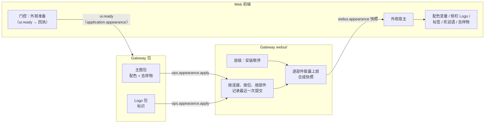

# 外观部件叠加与主页品牌设计方案

## 1. 元信息

| 项 | 内容 |
| --- | --- |
| 类型 | feature |
| 编号 / slug | `F_16 / layered-appearance-and-brand` |
| 建档日期 | 2026-11-23 |
| 范围 | agent-gateway `agent_gateway/extensions_v2/`（外观接口、层级与合成、声明槽位、候选提示）；jiuwenswarm `jiuwenswarm/channels/web/app_web.py` 与前端（门控、外观应用、主页四处显示） |
| 方案成熟度 | 产品决策已确认（第 4.2 节），待模块维护者评审；Gateway 侧与 jiuwenswarm 侧（`app_web`、前端）均已实现，均未推送；agent-gateway 固定提交升级（I-11）待 Gateway 侧合入后进行 |
| 计划条目 | [EXTV2-GW-16](../designs/extensions-v2-development-plan.md) |
| 整体设计 | [应用级界面能力设计概览](../designs/application-surfaces-overview.md) 第 3.1、3.3 节 |
| 设计依据 | [S_08 受控外观](../specs/S_08_appearance.md)、[S_09 启动门控](../specs/S_09_startup-splash.md)、[S_10 第 4 节](../specs/S_10_application-settings.md)、[S_02 槽位](../specs/S_02_ui-render.md)、[S_06 浏览器桥接](../specs/S_06_local-browser-bridge.md)、[S_07 媒体容器](../specs/S_07_media-surface.md) |
| 关联 feature | 延续 [F_11 受控外观](F_11_controlled-appearance.md)（提供者规则由本方案替代）与 [F_12 启动门控](F_12_startup-gate-and-splash.md)（门控增加外观准备） |
| 验证摘要 | 2026-11-23 Gateway、`app_web` 与前端单元验证通过，隔离实例中的浏览器预览通过（第 8.2 节）；真实 AgentServer 与桌面打包版联调未执行 |
| Refs | 未关联 issue；需求与决策来自 2026-11-17～2026-11-23 的产品讨论 |

契约已迁入主责规约：外观部件、层级与快照帧见 S_08，声明槽位、平台帧、提示与门控见 S_09（第 5.3 节列出对应位置）。
本文维护决策、设计依据与验证记录；第 5.4～5.6 节保留合成算法与前端实现说明，实现中的调整见第 10 节。

## 2. 背景、目标与范围

### 2.1 背景与问题

已核实的现状（agent-gateway develop `6f36398`、jiuwenswarm develop `b9da49f`）：

- 主页的品牌元素在前端写死：侧栏 Logo（`components/SessionSidebar/index.tsx` 引入 `/logo.svg`）、
  浏览器标签（`index.html` 的 `<title>WorkSwarm</title>` 与 `rel="icon"`）、欢迎语（`components/ChatPanel/index.tsx`
  的 `WelcomeHeading`，品牌词与按模式二选一的后半句都写在代码中）、吉祥物（同文件 `BeeBanner`，静态图与悬停动图）。
  开场中性层（`index.html` 的 `#workswarm-neutral`）同样显示 `/logo.svg` 与 “WorkSwarm”。
- V2 外观只有配色（S_08 第 2 节）。每个连接只认一个提供者，包提交非空外观即替换此前其他包的全部外观
  （S_08 第 5 节）。Logo 插件与主题插件因此不能同时生效：后提交的一方会清掉另一方。
- 外观只能在带浏览器连接的事件中提交，要等连接建立、包响应后才到达。门控只等待开场（S_09 第 5 节），
  同一启动内刷新时立即开放，界面会先显示默认样式再切换。

推断（依据 S_08 第 5 节与 S_09 第 3.2 节，尚未实测）：重连后各包重新提交外观，按“最后提交者为提供者”，
结果取决于各包应答的先后，同一组插件在不同重连中可能得到不同的外观。

### 2.2 目标与关键场景

| 场景 | 当前行为 | 目标行为 |
| --- | --- | --- |
| 只装主题插件（配色、吉祥物） | 只能改配色 | 配色与吉祥物生效 |
| 只装 Logo 插件（标识） | 不支持 | 侧栏 Logo、标签图标与标题、欢迎语中的品牌名变为插件提供的内容 |
| 两者同时安装 | 后提交者覆盖前者的全部外观 | 各自的部件同时生效 |
| 两个包都提供吉祥物 | — | 后安装的包生效；停用它后另一个包的吉祥物出现 |
| 下层包切换主题后重新提交 | 成为唯一提供者 | 层级不变，只更新它自己的值 |
| 装有外观插件时打开、刷新或新开窗口 | 先显示默认品牌再切换 | 门控期间中性层显示上次的品牌，开放时已是插件外观 |
| 外观插件响应慢或出错 | — | 至多等待 3 秒后开放；迟到的外观到达后再应用 |
| 插件卸载、停用或重载 | 撤销其外观 | 撤销其部件，下层或宿主默认随即显示 |
| 品牌图片加载失败 | — | 该处显示宿主默认 |

### 2.3 本次范围与非目标

- 本次包含：外观拆成四个部件（配色、标识、欢迎语、吉祥物）并按部件分层叠加；`ops.appearance.apply` 的部件写法与
  旧写法兼容；完整快照的下行帧；层级记录；声明槽位 `application.appearance` 及其平台帧；候选提示的外观字段；
  门控中的外观准备与首帧记录；主页四处显示：侧栏 Logo、浏览器标签的图标与标题、欢迎语、吉祥物；
  登录页与连接授权弹窗中的 Logo（D-12 修订，第 10 节）。
- 本次不包含：分享图导出中的 Logo；桌面程序图标与 Electron 加载页（运行时无法更换）；
  群聊创建页的横幅与品牌名；用户调整层级的设置界面；暗色模式专用外观；AgentServer 一侧的包提交外观。

## 3. 设计约束、假设与待决问题

- 已确认约束与依赖：
  - Gateway 侧代码在 agent-gateway，前端与 `app_web.py` 在 jiuwenswarm；jiuwenswarm 在 `pyproject.toml` 中固定
    agent-gateway 的提交（当前 `dda0e95`）。下行帧格式变化须与前端在同一次版本升级中交付。
  - S_08 不变量 1～4、6、7 的保证继续成立：只改宿主列出的变量；文本颜色不受影响；身份来自调用上下文；
    不改变明暗主题；包释放后浏览器最终不保留其外观。
  - 素材请求经 `gateway.request`（F_08 D-03）。未登录时，登录插件可能拒绝素材请求。
  - 显示型槽位的生命周期帧绕过请求策略、登录前可用，包 Handler 时限 5 秒（S_09 第 3 节）。
- 关键假设：外观包在 `application.appearance` 的 `ui.ready` 中只需读取自身偏好再提交，3 秒内可以完成。
  核实方式：联调中记录门控各阶段耗时。假设不成立时，门控按时限开放，外观晚到，体验退回现状。
- 待决问题：
  - 模块维护者对 S_08 提供者规则调整（D-01～D-03）的评审意见。影响 Gateway 实现，不影响前端的显示部分。
  - 无其他待决问题。用户调整层级的界面列为遗留（第 9.2 节）。

## 4. 总体方案与设计取舍

### 4.1 方案概览

外观由四个部件组成，每个部件独立确定生效的提供者。Gateway 为每个连接记住各包在各部件上最近一次提交的值，
按包的层级（安装顺序，后装在上）为每个部件取最上层的值，合成完整快照，经 `webui.appearance` 下发。
前端按快照应用配色，并显示 Logo、标签、欢迎语与吉祥物。包在 manifest 中声明 `application.appearance`，
宿主据此在门控中先向它们发送 `ui.ready`、收集外观，再进入开场队列并开放界面。



箭头为调用或消息方向。门控的 `ui.ready` 经 Gateway 并行触发到各声明包，包在 Handler 中提交外观。

### 4.2 关键决策

确认依据：2026-11-23 的讨论中，需求方确认了 D-01（含四个部件的划分）、D-02、D-03、D-09、D-11、D-12 以及第 2.3 节的范围。
D-04～D-08、D-10 是据此展开的设计选择，随本方案一并评审。

#### D-01 外观按部件确定提供者

部件为配色、标识、欢迎语、吉祥物。每个部件在每个连接上至多一个生效提供者，互不影响，Logo 插件与主题插件可以同时生效。
配色沿用 S_08 第 2 节的字段，作为一个部件整体生效。

#### D-02 层级按安装顺序，后装在上

层级取自 Gateway 保存的安装顺序记录，不取提交时间。按提交时间排序时，重连、门控准备都会让各包重新提交，
结果取决于应答先后；下层包切换主题时重新提交，也会突然跳到上层。安装顺序稳定，与“后来的在上面”的预期一致。
用户通过停用或卸载上层包来选择；记录格式与开场的安装顺序一致（S_10 第 4 节），以后增加用户顺序时不需要改变层级模型。

#### D-03 叠加：上层撤回后下层露出

Gateway 保留每个包在每个部件上的最近一次值。上层包撤回某部件、被停用或卸载后，该部件取下一层的值，
没有任何值时用宿主默认。这改变了 S_08 中“撤销后回到宿主默认、被替换的提供者不再生效”的规则。

#### D-04 部件整体生效，不与下层同部件合并

部件内缺省的字段取宿主默认，不从下层同部件补齐。例如上层标识只给 Logo、下层标识给了名称时，显示上层 Logo 与宿主默认名称。
这样同一部件的内容总是来自同一个包，不会拼出一个包的 Logo 配另一个包的名称。

#### D-05 沿用 `ops.appearance.apply`，部件写法为规范写法

外观对象以部件为键。只含配色字段的平铺对象视为配色部件，现有插件不必修改。一次调用只改变它带出的部件，
`null` 撤回本包的该部件，`apply(None)` 撤回本包的全部部件。不另设品牌接口，避免两套提供者规则。

#### D-06 下行帧为合成后的完整快照

层级与包生命周期只有 Gateway 知道，因此由 Gateway 合成。每帧携带全部生效部件及其提供者，不发增量；
浏览器按 `revision` 只保留最新一帧，重复或乱序的帧无副作用。

#### D-07 品牌素材只来自调用包自己

标识与吉祥物的图片只能是调用包当前激活的包素材或数据素材，格式与大小受限，显示尺寸由宿主固定。
撤回或释放包时，它提供的图片随之消失，不会显示其他包的素材。

#### D-08 声明槽位 `application.appearance`

包以 `web.slot.contribution` 声明该槽位，表示自己提供外观、需要在启动时被等待。该槽位不渲染内容，
它的 `ui.ready` 是平台帧：绕过请求策略、登录前可用。宿主并行通知各声明包，全部返回后回执。
候选提示据此静态判断是否有外观提供者，不运行包代码。未声明的应用级 UI 包仍可在其他事件中提交外观，只是门控不等待它。

#### D-09 外观等待并入开场门控，每次打开页面都执行

开场每次启动只播放一次；外观准备在每次打开页面（含刷新与新开窗口）时都执行，否则刷新仍会闪过默认品牌。
外观准备总时限 3 秒。

#### D-10 首帧与浏览器标签使用上次的标识记录

中性层与浏览器标签在门控期间可见。前端在本地记录上次生效的标识，`index.html` 的内联脚本在首帧使用它，
门控结束后以实际结果更新记录。

#### D-11 欢迎语的组成

欢迎语为“品牌名 + 后半句”。品牌名来自标识部件；后半句来自欢迎语部件，按工作模式给出，另有默认值，
每条文字都有中文与英文。缺失的部分用宿主默认文字。

#### D-12 范围限主页四处（2026-11-23 修订：增加登录页与连接授权弹窗的 Logo）

侧栏 Logo、浏览器标签的图标与标题、欢迎语、吉祥物。其余位置见第 2.3 节的非目标与第 9.2 节的遗留。
同日产品决定把登录页与连接授权弹窗的 Logo 一并纳入，与侧栏共用加载与失败回退（第 10 节）。

#### D-13 欢迎语只开放高亮色（2026-11-23 产品确认，同日修订）

欢迎语的样式只开放高亮色（单色或双色渐变），宿主按页面底色保证 3:1 对比度；字体不开放。
高亮色缺省只用于品牌名；同日产品追加“自定义欢迎语也可以采用主题配色”，`highlightScope: "line"` 让后半句也使用高亮色（第 10 节）。
备选为“高亮色加宿主白名单字体”和“插件自带字体文件”，前者扩大了宿主需要维护的样式面，后者有中文字体体积、首屏闪烁与授权问题，均未采用。
同日确认：主题壁纸插件提供主题风格的 Logo 与欢迎语，但品牌名始终为 WorkSwarm，插件不提交 `identity.name`。

### 4.3 替代方案与排除理由

| 候选 / 关联决策 | 关键差异 | 排除原因 | 重新评估条件 |
| --- | --- | --- | --- |
| R-01 / D-01 在外观对象中加字段，仍为单一提供者 | 改动最小 | Logo 包会替换主题包的配色 | 不再需要多个外观包共存时 |
| R-02 / D-01 独立“品牌”接口，品牌单一提供者 | 配色与品牌分开 | 主题包的吉祥物与 Logo 包的标识同属品牌，仍会互相替换 | — |
| R-03 / D-08 在欢迎区、侧栏新增可渲染槽位 | 插件渲染组件树 | 文字与 Logo 套组件树过重，易破坏版式；悬停换图不便实现 | 需要插件自定义主页区块时 |
| R-04 / D-02 按最后提交确定层级 | 无需记录 | 结果取决于应答先后；主题切换会改变层级 | — |
| R-05 / D-09 浏览器缓存外观，先显示后核对 | 不延迟首屏 | 需求方选择并入门控；卸载后的首屏仍会短暂显示旧品牌 | 门控等待被证实影响体验时 |
| R-06 / D-08 声明中列出提供的部件 | 宿主事先知道每个包提供什么 | 门控只需知道要不要等待，部件在提交时校验即可 | 设置界面需要展示“谁提供什么”时 |
| R-07 / D-06 前端合成层级 | Gateway 只转发 | 前端不知道安装顺序与包的释放 | — |

## 5. 详细设计

### 5.1 模块责任与关键不变量

| 模块 | 责任 |
| --- | --- |
| Gateway `webui/appearance.py` | 部件校验（含旧写法）、按连接分层记录、合成快照、释放与断开连接时清理 |
| Gateway `webui/host_settings.py` | 外观层级记录 `host/appearance.json` 的读写 |
| Gateway `webui/bridge.py` | `ops.appearance.apply` 的部件语义与返回值；包释放时重新合成并下发；`application.appearance` 声明校验与平台帧 |
| Gateway `webui/constants.py` | 槽位表增加 `application.appearance` |
| Gateway `splash_hint.py` | 静态计算已安装的外观提供者 |
| jiuwenswarm `channels/web/app_web.py` | 候选提示增加 `appearance` 字段 |
| 前端 `features/webui/appearance/`、`react/WebUIAppearanceHost.tsx` | 校验并应用快照；配色派生不变；向主页组件提供标识、欢迎语、吉祥物 |
| 前端 `features/webui/splash/`、`react/WebUISplashGate.tsx` | 外观准备阶段、首帧记录、开场排序取配色部件提供者 |
| 前端 `index.html`、`components/SessionSidebar/`、`components/ChatPanel/` | 首帧与标签、侧栏 Logo、欢迎语、吉祥物 |

本次修订后的关键保证（实现时写入 S_08 第 6 节，替代原不变量 5）：

1. 每个连接上，每个部件至多一个生效提供者，即层级最高且提交了该部件的活动包。
2. 生效结果只取决于各包当前的提交与层级记录，与提交、应答的先后无关。
3. 包释放后，浏览器最终显示的快照中不含该包的任何部件（沿用原不变量 7 的在途帧与排队调用处理）。
4. 品牌图片只来自其提供者自己的素材；文字只按纯文本显示。

### 5.2 数据模型与事实归属

| 数据 | 语义与隔离范围 | 权威位置 | 创建、更新与释放 |
| --- | --- | --- | --- |
| 包的部件提交 | 某连接上某包对某部件最近一次提交的值 | Gateway 内存，按连接 → 包 → 部件 | `apply` 写入或删除；包释放时删除该包的全部记录；连接关闭时删除该连接的全部记录 |
| 外观层级记录 | 应用级 UI 包的安装顺序 | `<data_dir>/host/appearance.json`：`{"version": 1, "installed": [...]}`，原子替换写入 | 包首次发布时追加到末尾；记录建立前已安装的包按首次启动时的发布顺序；重载、升级、重启保留；卸载时删除；无法读取时按空记录处理并记录警告 |
| 快照版本 | 每个连接的 `revision` | Gateway 内存 | 每次下发递增；释放时预留；连接关闭时删除 |
| 首帧记录 | 上次的外观准备结果与上次生效的标识 | 浏览器本地存储 `workswarm.appearance.expected`、`workswarm.appearance.identity` | 外观准备结束及之后每次快照变化时更新；没有外观提供者时清除标识记录 |
| 上次配色提供者 | 外观准备超时时开场排序的后备 | 浏览器本地存储 `workswarm.appearance.provider`（已存在） | 改为记录配色部件的提供者 |

层级：在记录中的位置越靠后，层级越高；不在记录中的包排在全部已记录包之下，按发布顺序排列。

### 5.3 接口定义与消息契约

契约在规约中维护，本文不重复定义：

| 契约 | 位置 | 实现状态 |
| --- | --- | --- |
| `ops.appearance.apply` 的部件写法、旧写法兼容与返回值（含 `shown`） | [S_08 第 1 节](../specs/S_08_appearance.md) | Gateway 已实现 |
| 部件字段、文本与图片规则（含所有权与大小上限） | [S_08 第 2 节](../specs/S_08_appearance.md) | 已实现（两端） |
| 快照帧 `webui.appearance` | [S_08 第 4 节](../specs/S_08_appearance.md) | 已实现（两端） |
| 层级、叠加、释放与层级记录 | [S_08 第 5 节](../specs/S_08_appearance.md) | Gateway 已实现 |
| 主页品牌显示 | [S_08 第 3.3 节](../specs/S_08_appearance.md) | 前端已实现 |
| 声明槽位 `application.appearance` 与其 `ui.ready` | [S_09 第 2、3.4 节](../specs/S_09_startup-splash.md) | Gateway 已实现 |
| 候选提示的 `appearance` 字段 | [S_09 第 4 节](../specs/S_09_startup-splash.md) | 已实现（Gateway 判定函数、`app_web`） |
| 外观准备与首帧记录 | [S_09 第 4、5 节](../specs/S_09_startup-splash.md) | 前端已实现 |

### 5.4 层级与合成

```text
compose(connection):
    for part in [colors, identity, welcome, mascot]:
        candidates = 在此连接上提交了 part 的活动包
        provider = candidates 中层级最高者
        snapshot[part] = {package_id: provider, value: 该包的 part 值}（无候选时省略）
```

- 每次 `apply` 改变记录后，在连接锁内重新合成；合成结果与上次下发的快照不同才下发新帧。
- 包释放：删除该包在全部连接上的记录；对该包在其上有记录、或外观帧仍在发送的连接预留新的 `revision`，
  并在连接锁内下发重新合成的快照（排在在途帧之后）。快照在发送时合成，因此包含释放后已完成的调用；
  该包只在下层时，这一帧与浏览器已显示的内容相同（第 10 节）。
- 层级记录变化（安装、卸载）只影响之后的合成；安装新包不会立即改变现有快照，直到新包提交。

### 5.5 门控中的外观准备

阶段、时限与首帧记录的契约见 [S_09 第 4、5 节](../specs/S_09_startup-splash.md)。前端实现：

- 门控（`WebUISplashGate`）在挂载时创建外观准备（`features/webui/appearance/preparation.ts`）与开场控制器；
  外观准备放在开场队列之前，开场播放时配色与品牌已经生效，开场排序取本次快照的配色提供者。
- 外观准备以 `application.appearance` 声明槽位挂载一个不指定包的消费者，连接、重连与上下文变化时由运行时重发
  `ui.ready`；包变化（`extensions.v2.installed`）后运行时只向该包重发。每次发送前运行时暂存后到的快照
  （`holdAppearance`），回执到达或 3 秒后释放，只显示最新一份，避免各包先后提交造成闪动。
- 首帧记录只保存标识（名称与两张图片的地址），不保存配色与吉祥物：门控层盖住了它们，开放前已由本次快照替换。
  品牌位置通过门控提供的上下文取标识：外观准备结束前为记录，之后为当前快照。

### 5.6 主页显示

见 [S_08 第 3.3 节](../specs/S_08_appearance.md)。四处显示都读取同一份快照；群聊创建页的欢迎区不变。

### 5.7 异常与边界

- 外观对象不合法、调用方不是应用级 UI 包、激活已失效或没有连接：抛出 `ValueError`，不改变记录、不下发。
- 外观准备超时或没有包处理：按时限开放，界面使用当前已有的快照；后续快照到达时应用。
- 外观包 Handler 出错：该包视为未处理，不影响其他包；回执取决于其余包。
- 素材请求被登录插件拒绝（未登录时）：对应位置显示宿主默认，登录后重新加载。
- 首帧记录与当前包不一致（例如卸载后首次打开）：中性层短暂显示旧品牌，外观准备结束后按实际结果更新。
- 层级记录无法写入：本次运行按内存中的顺序工作并记录警告，重启后可能按发布顺序重建。

### 5.8 并发与一致性

沿用 S_08 第 5、6 节的连接锁、在途帧登记与释放时预留 `revision` 的做法；合成在连接锁内进行，
因此同一连接上的快照按 `revision` 严格递增，且包释放后的快照晚于该包的任何在途帧。
取得连接锁后再次核对激活；已释放包的排队调用不下发任何帧（原不变量 7）。

### 5.9 安全与授权边界

- 包只能设置、撤回自己的部件；包身份与连接来自调用上下文。
- 品牌图片只能是调用包自己的素材地址，宿主以 `` 显示，SVG 中的脚本不会执行。
- 文本按纯文本插入，不解析 HTML 或 Markdown。
- `application.appearance` 的 `ui.ready` 没有载荷，不携带用户输入。

## 6. 影响面与实施设计

### 6.1 修改点与实施顺序

| 实施项 | 仓库 / 文件或符号 | 修改内容 | 前置 / 验证 |
| --- | --- | --- | --- |
| I-01 | agent-gateway 规约 | 把第 5.3～5.8 节迁入 S_08、S_09，同步第 6.2 节所列文档 | 评审通过；文档检查 |
| I-02 | `webui/appearance.py` | 部件校验与旧写法；`AppearanceProviders` 改为分层记录与合成 | V-01～V-03 |
| I-03 | `webui/host_settings.py` | 外观层级记录 | V-03 |
| I-04 | `webui/bridge.py`、`webui/constants.py`、`runtime.py` | `apply` 的部件语义与 `shown`；释放时合成；声明校验；`application.appearance` 平台帧与并行分派 | V-02～V-05 |
| I-05 | `splash_hint.py` | 已安装的外观提供者 | V-06 |
| I-06 | Gateway 测试与共享用例 | `test_gateway_appearance.py`、`test_gateway_splash.py`、`fixtures/gatewayAppearanceCases.json` | I-02～I-05 |
| I-07 | jiuwenswarm `channels/web/app_web.py` | 提示增加 `appearance`；`tests/unit_tests/channels/web/test_app_web_splash_hint.py` | I-05 合入；V-06 |
| I-08 | jiuwenswarm 前端 `features/webui/appearance/`、`transport/`、`catalog/slots.ts`、`react/WebUIAppearanceHost.tsx` | 快照校验与应用；声明槽位 | V-07 |
| I-09 | 前端 `features/webui/splash/`、`react/WebUISplashGate.tsx`、`index.html` | 外观准备、首帧记录、开场排序 | V-08、V-09 |
| I-10 | 前端 `components/SessionSidebar/index.tsx`、`components/ChatPanel/index.tsx` | 主页四处显示 | V-10 |
| I-11 | jiuwenswarm `pyproject.toml`、`uv.lock` | agent-gateway 固定提交升级到 I-02～I-06 合入后的版本 | 与 I-07～I-10 同一 PR |
| I-12 | 示例与插件 | 最小 Logo 示例包；主题插件声明 `application.appearance` 并提交吉祥物（插件仓库，不在本仓） | V-11 |

顺序：I-01 → I-02～I-06（agent-gateway 一个 PR）→ I-07～I-11（jiuwenswarm 一个 PR）→ I-12 与联调。

### 6.2 文档同步

- spec：S_08 第 1、2、4～7 节（部件、快照帧、层级与叠加、不变量 5 的替代）；S_09 第 2、3.2、4～7 节
  （声明槽位、平台帧、提示字段、外观准备、首帧记录）；S_10 第 4 节“前端合并”（改为配色部件的提供者）；
  S_02 槽位表；S_06 第 1 节应用级槽位列表与平台帧列表；S_01 包释放语义中“撤销该包作为提供者的外观”的措辞。
- 设计概览：第 2.2 节“开场提供者顺序”、第 3.3 节（叠加与恢复默认）、第 5 节条目表。
- 开发计划：EXTV2-GW-16 条目、依赖、验证要求与进度台账（本次已建立）。
- 关联 feature：F_11 第 4.2 节 D-03、F_13 D-03 注明由本方案替代的范围。
- 前端文档：jiuwenswarm `features/webui/docs/` 中描述外观与门控的部分，随 I-08、I-09 同步。
- 用户文档：agent-gateway `docs/zh`、`docs/en` 目前没有 Extension V2 的章节，本次不新增；插件作者文档的归属另行确定。

## 7. 兼容与迁移

- 旧写法：只含配色字段的对象继续有效，视为配色部件。
- 行为变化：此前任何包提交都会替换全部外观，现在只影响同一部件且按层级生效。下层包后提交的配色不再生效，
  返回 `applied` 且 `shown` 中不含 `colors`；需要始终生效的包应位于上层（后安装）。
- 帧格式：新快照与原 `{"package_id", "revision", "appearance"}` 不兼容。jiuwenswarm 在同一 PR 中升级前端与 agent-gateway 固定提交；
  不支持新 Gateway 搭配旧前端。
- 层级记录：首次启动时建立；已安装的包按首次启动时的发布顺序。
- 回退：两个 PR 一起回退；`host/appearance.json` 可留在数据目录，旧版本不读取。

## 8. 验证设计、执行记录与结论

### 8.1 验证设计与通过条件

| 验证 ID | 场景 | 通过条件 | 层级 |
| --- | --- | --- | --- |
| F_16-V-01 | 部件校验 | 共享用例中各部件、旧写法、混用、文本与地址边界在两端结论一致 | Gateway 单测 + 前端 `test:webui-components` |
| F_16-V-02 | `apply` 语义 | 设置、撤回单个部件、撤回全部；返回状态与 `shown`；非法调用不改变记录、不下发 | Gateway 单测 |
| F_16-V-03 | 层级与叠加 | 两包不同部件同时生效；同部件后装在上；上层撤回或释放后下层露出；提交先后不影响结果；层级记录的追加、卸载删除、重启保留、损坏回退 | Gateway 单测 |
| F_16-V-04 | 释放与并发 | 释放时重新合成且 `revision` 不复用；在途帧之后到达；已释放包的排队调用不下发 | Gateway 单测（沿用 F_11 的帧序构造） |
| F_16-V-05 | 声明与平台帧 | 非法声明使发布失败；向该槽位渲染被拒；请求策略拒绝一切时 `ui.ready` 仍到达各包；并行分派；三种回执 | Gateway 单测 |
| F_16-V-06 | 候选提示 | 有、无外观声明，扩展未启用、配置无效与取不到提示时的值 | Gateway 与 `app_web` 单测 |
| F_16-V-07 | 前端快照 | 合法快照应用、非法与旧 `revision` 忽略；重连期间暂存、回执后只应用最新；无快照时恢复默认 | 前端 `test:webui-runtime` |
| F_16-V-08 | 门控 | 提示为是、否、未知三条路径；同一启动刷新时仍做外观准备；3 秒时限；与开场同时存在时的顺序与开场排序 | 前端 `test:webui-components` |
| F_16-V-09 | 首帧与标签 | 记录存在、缺失、图片失败时的中性层、标题与图标 | 前端用例 + Chromium |
| F_16-V-10 | 主页显示 | 四处在有、无部件和加载失败时的显示；欢迎语按模式与语言取值；吉祥物悬停 | 前端用例 + Chromium |
| F_16-V-11 | 真实联调 | 隔离实例中安装主题插件与 Logo 示例：两者同时生效；停用上层后下层露出；打开、刷新、新开窗口不闪默认品牌；卸载后恢复 | Chromium 无头 + 桌面打包版 |
| F_16-V-12 | 回归 | Gateway 扩展、Web 渠道与前端 WebUI 各套件；`tsc` 与 `npm run build` | 全量单测与构建 |

### 8.2 实际执行与证据

| 执行日期 / 验证范围 | 实现版本与环境 | 命令 / 记录 | 实际结果 | 未覆盖项 |
| --- | --- | --- | --- | --- |
| 2026-11-23；V-01（Gateway 一侧）、V-02～V-06 | agent-gateway develop `6f36398` 加本特性的 Gateway 改动；Python 3.11.17，隔离环境 `.venv-bm-develop`，agent-core 为本地 `c48b5bb`（仓库锁定 `f5ecfd7`，本机未安装）；`JIUWENSWARM_DATA_DIR` 指向临时目录 | `python -m pytest tests/unit_tests/gateway/extensions_v2/test_gateway_appearance.py -o addopts="--strict-markers --tb=short --asyncio-mode=auto"` | 107 通过 | 无 |
| 同上；新用例在改动前失败 | 同一提交未改动的临时工作树，只复制新的测试文件与共享用例（缺失的导入以空值代替） | 同上，只选新增与改写的用例 | 13 个行为用例全部失败；共享用例中合法用例因返回格式变化失败；非法用例在旧代码上同样被拒 | 无 |
| 同上；V-12（Gateway 一侧） | 同上 | `python -m pytest tests/unit_tests/gateway/extensions_v2 -o addopts="--strict-markers --tb=line --asyncio-mode=auto"`，改动前后各一次 | 改动后 718 通过、43 失败；改动前 664 通过、43 失败，两次失败的用例集合完全相同 | 43 项失败来自本地 agent-core 缺少 `Manifest.enable`、`PackageManager.set_enabled` 等新接口，集中在包管理、应用设置与包数据用例，与本特性无关 |
| 同上；全部单元用例 | 同上 | `python -m pytest tests/unit_tests --continue-on-collection-errors -o addopts="--strict-markers --tb=line --asyncio-mode=auto"`，改动前后各一次 | 改动后 4956 通过、56 失败、4 跳过、18 个收集错误；改动前 4902 通过，失败与收集错误的集合完全相同 | 18 个收集错误来自本机未安装的 `openjiuwen_runtime`、`minio` 等依赖；未在仓库锁定的依赖版本上运行 |
| 2026-11-23；V-06（`app_web`） | jiuwenswarm develop `b9da49f` 加本特性的改动（分支 `feat/home-page-brand`），`PYTHONPATH` 指向上面的 Gateway 改动；同一隔离环境 | `python -m pytest tests/unit_tests/channels/web/test_app_web_splash_hint.py` | 5 通过（新增 2 项：外观提示的判定规则、读取失败按无） | 无 |
| 同上；V-01（前端一侧）、V-07、V-08、V-09、V-10 | 同上；Node 22.23.4，前端依赖复用本机已有的 `node_modules`（缺 `@modelcontextprotocol/ext-apps`、`oidc-client-ts`） | `npm run test:webui-runtime`、`npm run test:webui-components` | runtime 26 通过；components 427 通过（新增 41 条共享校验用例与 12 个行为用例：提示字段、欢迎语取值、外观准备的暂存与记录、3 秒时限、刷新与开场路径、门控中性层与开场排序、针对单包的 `ui.ready`、图片回退、首帧脚本、主页四处） | 共享用例在 Gateway 与前端各存一份副本，靠复制保持一致 |
| 同上；V-12（前端） | 同上；对照为同一提交未改动的临时工作树，`node_modules` 相同 | `package.json` 中全部 277 个 `test:*` 脚本与 `tsc --noEmit -p tsconfig.json`，改动前后各一次 | 只有 `test:webui-components`（374 → 427）与 `test:webui-runtime`（24 → 26）不同，均全部通过；其余脚本结果相同，前后都有 33 个脚本失败（缺上述两个包，或 develop 本身的失败用例）；`tsc` 前后是相同的 12 个错误，全部来自缺失的两个包 | `npm run build` 因缺包无法执行 |
| 同上；V-09、V-10、V-11（部分） | 隔离实例 `.tools/v2-instance-brand`：上面的 Gateway（web 26000）；AgentServer 由只回 `connection.ack`、让请求立即失败的替身代替（本机 agent-core `c48b5bb` 无法启动 develop 的 AgentServer）；Vite 开发服务器（9273），两个缺失的包以本地占位模块代替；两个演示包：先装 `demo-hive-theme`（配色与吉祥物），后装 `demo-brand-logo`（标识与欢迎语） | 应用内浏览器打开首页、刷新、卸载与重装上层包，读取页面状态并截图 | 两包的部件同时生效（强调色 `#b45309`、蜜蜂吉祥物、名称 Nebula、Logo、欢迎语、标签标题与图标）；安装后不刷新即生效；刷新时中性层显示记录中的品牌，门控约 1.3 秒开放，期间标签标题保持记录；卸载上层包后不刷新即恢复宿主品牌，下层的配色与吉祥物保留，标识记录被清除 | 开发模式没有 `/extension-splash/hint`，门控只走提示未知的路径；聊天与会话不可用；吉祥物悬停图被宿主原有的悬停提示遮挡，未看清；真实 AgentServer、登录插件与桌面打包版未覆盖 |

测试的整理：5 个测试文件此前使用默认的相对数据目录（`extension/gateway`）。本特性在包首次发布时写入层级记录，
这些用例因而会在仓库目录下生成 `extension/gateway/host/appearance.json`；已改为使用各自的临时数据目录。
`test_gateway_host_actions.py` 中一处断言改读新的快照格式。

### 8.3 验证结论

- 已证明范围：Gateway 侧的部件校验、`apply` 语义、按安装顺序叠加、释放与在途帧、品牌图片所有权与大小、声明槽位与
  平台帧的并行分派、候选提示的静态判定；`app_web` 的提示字段；前端的快照校验与暂存、门控外观准备、首帧记录与主页四处，
  均在单元范围内成立，其余用例没有新增失败。浏览器预览中，两包叠加、安装与卸载后的即时更新、刷新时的首帧品牌均符合设计。
- 未覆盖：真实 AgentServer 与登录插件下的联调、桌面打包版、提示为是或否的门控路径在真实页面中的表现、`npm run build`。
- 交付判断：两侧可以提交评审；新帧格式与旧前端不兼容，jiuwenswarm 的 agent-gateway 固定提交（I-11）须在 Gateway 侧
  合入后升级，并与前端改动一起交付（第 7 节）。

## 9. 风险与已知遗留

### 9.1 设计风险

| 风险 / 触发条件 | 影响 | 应对 | 核实方式 |
| --- | --- | --- | --- |
| 每次打开都等待外观准备 | 装有外观插件时打开页面变慢，至多 3 秒 | 时限 3 秒；包 Handler 只读偏好 | V-11 中记录各阶段耗时 |
| 包的版本化发布改变素材地址（agent-gateway 中进行中的包版本化工作） | S_08 第 2.7 节的地址规则需随之调整 | 2026-11-23 核对 !298（`3b39528a`）：只改包管理、Hub 与宿主兼容，不改素材地址 | 合入前再核对目标分支 |
| 同期修改 `webui/bridge.py` 的 !301（`1467093c`，包状态） | 与本特性在导入行和 `BrowserBridge.__init__` 附近相邻，合并时有文本冲突 | 冲突只在相邻行，两边逻辑互不依赖 | 先合入者之后，另一方变基并重跑扩展用例 |
| 未登录时素材被登录插件拒绝 | 中性层与侧栏显示宿主默认 Logo | 加载失败回退 | V-11 中覆盖登录插件场景 |

### 9.2 已知遗留

| 遗留项 | 性质 | 影响与处置 | 后续入口 |
| --- | --- | --- | --- |
| 用户调整外观层级的界面 | 范围外 | 只能通过停用、卸载、重装调整 | 在层级记录中增加 `order`，沿用 S_10 第 4 节的用户顺序规则 |
| 分享图中的 Logo | 范围外 | 仍为宿主 Logo | 另立条目 |
| 浏览器沿用缓存的标签图标 | 浏览器行为 | Safari 中替换图标、刷新同一地址或重新打开该地址后，仍可能显示缓存的旧图标；宿主已在每次替换时新建图标元素 | 观察；必要时为图标地址附加内容版本 |
| 桌面程序图标、Electron 加载页 | 运行时无法更换 | 仍为宿主品牌 | — |
| 群聊创建页的横幅与品牌名 | 范围外 | 不变 | 另立条目 |
| 暗色模式专用外观 | 沿用 F_11 遗留 | — | 概览第 1.3 节 |
| 多语言只支持中文与英文 | 与宿主界面语言一致 | 宿主增加语言时扩充 | — |
| 吉祥物悬停时宿主的提示气泡可能遮住吉祥物 | 宿主原有行为 | 与默认蜜蜂相同，本次不改 | — |
| 示例包与主题插件 | I-12 未完成 | 本地预览用的两个演示包只在隔离实例目录中；最小 Logo 示例包与主题插件更新另行完成 | 第 6.1 节 I-12 |

## 10. 设计演进与修订

### 2026-11-23 Gateway 实现中的调整

- 原结论与适用范围：第 5.4 节草案写的是只对“合成结果因此变化”的连接预留 `revision`；第 5.3.4 节草案写的是各包 Handler 时限 5 秒。
- 新证据与原因：释放发生在同步路径中，此时合成要等连接锁内才可靠；先判断“是否变化”需要在锁外合成，可能与锁内的调用交错。
  平台帧本来由宿主整体限时 5 秒。
- 最终变化：对该包在其上有记录或有在途帧的连接都预留 `revision`，在连接锁内合成并下发，结果可能与已显示内容相同；
  外观提供者的 `ui.ready` 由宿主并行触发、整体等待至多 5 秒（S_09 第 3.4 节）。另外，`HostActionOutput` 增加 `shown`，
  把调用包生效的部件带回 Ops 的返回值。
- 旧结论的效力：第 5.4 节已按新做法修改；契约以 S_08 第 5 节、S_09 第 3.4 节为准。
- 影响与同步：S_08、S_09、S_01（释放语义）已同步；浏览器多收到一帧相同快照，按 `revision` 处理无副作用。
- 验证：`test_releasing_the_upper_layer_shows_the_lower_one` 断言释放下层时的那一帧；第 8.2 节。

### 2026-11-23 欢迎语增加品牌名高亮色

- 原结论与适用范围：D-12 与 S_08 第 2.5 节只开放欢迎语后半句的文字，品牌名使用宿主正文颜色。
- 新证据与原因：产品希望主题能为主页欢迎语配色（D-13）。
- 最终变化：`welcome` 增加 `highlight`（1～2 个 `#RRGGBB`）；Gateway 与前端按共享用例校验（新增 7 条）；前端 `WelcomeHeading`
  对品牌名使用纯色或 `background-clip: text` 渐变，颜色经 `readableHighlight` 调整到与页面底色 3:1。
- 影响与同步：S_08 第 2.5、3.3 节已同步；旧前端收到带 `highlight` 的欢迎语会整帧拒绝（帧格式本就须两侧同时升级，第 7 节）。
- 验证：Gateway `test_gateway_appearance.py` 114 项通过（新增 7 条共享用例）；前端 `test:webui-components` 436 项通过，
  含高亮色在亮、暗底色上的对比度与品牌名纯色、渐变、撤回的显示用例；`tsc` 0 错误。

### 2026-11-23 欢迎语高亮色可用于整句

- 原结论与适用范围：D-13 初版只开放品牌名的高亮色，后半句颜色不开放。
- 新证据与原因：产品试用主题壁纸插件的“主页欢迎语”设置后，要求自定义欢迎语也可以采用主题配色。
- 最终变化：`welcome` 增加 `highlightScope`（`brand` 缺省、`line`），须与 `highlight` 同时提供；Gateway 与前端按共享用例校验
  （新增 5 条）；前端 `WelcomeHeading` 在 `line` 时对后半句使用与品牌名相同的纯色或渐变，对比度规则不变。
- 影响与同步：S_08 第 2.5、3.3 节已同步；旧宿主收到带 `highlightScope` 的欢迎语会拒绝整次提交，插件应在被拒绝时去掉欢迎语重试
  （主题壁纸插件 2.2.0 已如此处理）。
- 验证：Gateway `test_gateway_appearance.py` 119 项通过（新增 5 条共享用例）；前端 `test:webui-components` 441 项通过，
  含后半句随 `line` 着色、`brand` 与撤回后恢复宿主颜色的显示用例；`tsc` 0 错误。

### 2026-11-23 登录页与连接授权弹窗的 Logo、PNG 标签图标

- 原结论与适用范围：D-12 只覆盖主页四处，登录页与连接授权弹窗仍为宿主 Logo；宿主标签图标为 SVG，包的 `favicon` 缺省取 `logo`。
- 新证据与原因：试用主题壁纸插件时，Safari 的浏览器标签不显示 SVG 图标；登录页与授权弹窗仍是宿主 Logo，与主题不一致。产品决定一并纳入。
- 最终变化：jiuwenswarm 前端的侧栏、连接授权弹窗与登录页共用 Logo 加载与失败回退；登录页登录前没有 Gateway 连接，读取首帧记录中的标识。
  宿主默认标签图标改为 32 × 32 PNG（`public/favicon.png`）；首帧脚本与 `setFavicon` 按地址后缀设置图标类型，新图标加载成功后才替换，
  替换时新建图标元素。Gateway 契约不变：包仍通过 `identity.favicon` 提供标签图标（主题壁纸插件 2.2.1 提供 PNG）。
- 影响与同步：S_08 第 3.3 节已同步；第 2.3 节范围与第 9.2 节遗留已调整。
- 验证：前端 `test:webui-components` 443 项通过（新增标签图标替换顺序与登录页 Logo 回退两项，首帧脚本断言改为 PNG）；`tsc` 0 错误。

### 2026-11-23 jiuwenswarm 实现中的调整

- 原结论与适用范围：第 5.5 节草案与 S_09 第 5 节写的是每次打开页面都取提示并按提示等待；首帧记录由每个回执更新；
  第 6.1 节 I-10 只列出 `SessionSidebar/index.tsx` 与 `ChatPanel/index.tsx`。
- 新证据与原因：
  - 本启动已完成时，原门控不取提示、同步开放；改为每次都取提示后，没有外观插件的用户每次刷新都要多等一次本地请求。
  - 包变化后运行时只向该包重发 `ui.ready`，未声明外观的包回执“未处理”；若据此改写记录，会把仍有其他提供者的页面记为没有。
  - 门控在外观准备建立前渲染的外观宿主，会用宿主默认标题覆盖首帧脚本按记录设的标题（浏览器预览中观察到）。
  - `ChatPanel/index.tsx` 依赖本机缺失的包，品牌位置留在其中无法单独测试。
- 最终变化：
  - 本启动已完成且上次记录没有外观提供者时立即开放，不取提示；`ui.ready` 照常发送，回执更正记录。
  - 只有不指定包的 `ui.ready` 的回执更新首帧记录。
  - 提示中 `appearance` 为是时，门控等待期间显示中性层。
  - 门控的外观准备建立之前，外观宿主不改动标签。
  - 欢迎语与吉祥物移入 `ChatPanel/WelcomeBrand.tsx`，侧栏 Logo 移入 `SessionSidebar/SidebarBrandLogo.tsx`；宿主默认欢迎语移入语言资源。
  - 运行时增加 `holdAppearance()`；挂载选项的 `onReadyStart` 与 `onReadySettled` 增加目标包参数。
- 旧结论的效力：第 5.5 节已按实现改写；契约以 S_08 第 3.3 节、S_09 第 4、5 节为准。
- 影响与同步：S_08、S_09 已同步；jiuwenswarm 前端 `features/webui/docs` 的 S_01、F_01 槽位说明已同步。
- 验证：前端用例 `every page load waits for appearance providers, at most three seconds`（含刷新直接开放的断言）、
  `a ready for one changed package does not touch the first-paint record`、外观宿主用例中的标签断言；第 8.2 节。
