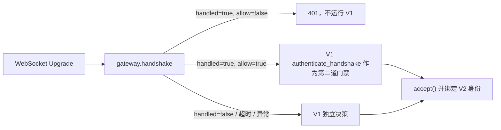

# gateway.handshake 设计方案

## 元信息

| 项 | 内容 |
| --- | --- |
| 类型 | feature |
| 编号 / slug | `F_17 / gateway-handshake` |
| 关联计划 | EXTV2-GW-17 `gateway.handshake` 与鉴权扩展挂点 |
| 所属模块 | `agent_gateway/extensions_v2/{models,event_types/gateway,bootstrap,runtime,__init__}.py`、`agent_gateway/channel_manager/web/web_channel_app.py` |
| 设计依据 | [运行时规约](../specs/S_01_gateway-extension-runtime.md)、[F_02](F_02_gateway-request-and-auth-gate.md) |
| 最近一次修订日期 | 2026-11-28 |
| 方案状态 | 已实现；新增用例通过，联合回归 223 项通过 |

## 1. 问题与目标

`gateway.request` 只在连接建立后的帧上触发，Upgrade 阶段扩展包没有参与点：无法在 `accept()` 前携带凭据完成准入，
也无法声明该连接的身份。渠道自带的 V1 钩子（`channel.authenticate_handshake`）只服务内置认证，扩展包只能改代码或另建入口。

一句话概括：**Upgrade 时先问扩展一次；扩展无意见就完全沿用 V1，扩展放行则仍让 V1 过一遍，且仅在显式绑定 V2 身份时把它作为连接身份，扩展拒绝就直接 401。**

配套的 `gateway.request` 字段扩展与 HTTP 业务分发触发点同属 GW-17，契约与实现见 [F_02](F_02_gateway-request-and-auth-gate.md) 第 4.1、4.2 节，本文不重复。

## 2. 范围与约束

### 2.1 本次范围

- 新事件 `gateway.handshake` 与数据类 `GatewayHandshakeInput`、`GatewayHandshakeOutput`。
- 对外入口 `authenticate_gateway_handshake()`：显式初始化运行时，不置 `_extensions_active`。
- `WebChannel` Upgrade 前的 V2/V1 合并，以及连接身份绑定。
- 演示包 `demo.ws.auth` 与 `test_gateway_auth_points.py` 中的握手用例。

### 2.2 非目标

- 不修改原生 `CredentialAuthenticator`、AgentOS IAM 校验与 Origin 校验。
- 不覆盖 TUI、IM 渠道与 AgentOS 南向连接。
- 不覆盖 AG-UI 的 `/api/ag-ui/run`：该入口仍只经过 V1 握手认证与 P3 前置中间件。
- 不提供登录态、会话目录或包级鉴权标记；凭据校验由扩展包自行完成。

## 3. 总体方案与取舍



### 关键决策

**默认"无意见"。** CORE 只校验输入类型并返回 `handled=false`、`allow=true`，扩展必须显式 `handled=true` 才接管握手。
空总线、未订阅、链异常都不会被误判为放行或拒绝。

**与 V1 叠加，不替换。** 合并规则固定在 `web_channel_app._reject_unauthorized_handshake()`：
`handled=true` 且 `allow=false` 直接 401、不再调用 V1；`handled=true` 且 `allow=true` 仍执行 V1 作为第二道门禁，绑定 V2 身份时最终身份取 V2，否则保持 V1；
若 V2 绑定的身份与 V1 结果不一致，以 V2 为准并写 WARNING 日志，便于排查双方策略差异；
`handled=false`、超时或异常完全保持 V1 行为。这样即使扩展只做了一部分校验，原生门禁仍然生效。

**V2 拒绝是补充门禁，不是可靠的 fail-closed 门禁。** 以下情况 V2 的拒绝不会生效，连接按 V1 的结果继续：
握手链超过 `REQUEST_TIMEOUT_S`（默认 5 秒，每个受影响的握手都会先等待该超时）、处理器抛错后总线落到无意见结果、运行时装配失败。
需要可靠拒绝的部署应把策略放在 fail-closed 的 `http_pre_route`；握手阶段只适合作为尽力而为的前置校验。

**连接身份需要显式声明。** 只有 `bind_connection_identity=true` 且 `user_id` 非空时才把该身份绑定到连接；
仅返回 `user_id` 不改变连接身份，避免扩展随手回填一个用户名就提权。未绑定的 `user_id` 不写入适配器的
`authenticated_user_id` / `verified_user_id`（二者参与后续授权判定），只作为扩展链输入保留。

**输入来自握手请求的唯一视图。** `path`、`headers`、`query`、`remote_addr`、`channel_id`、`transport` 均取自 Upgrade 请求，
`headers` 键统一小写。凭据与身份类单值头（`authorization`、`x-token`、`x-user-id`、`x-auth-session`、`x-group-id`、
`x-bot-id`、`x-gateway-id`）重复出现时，握手入口直接 401（错误码 `DUPLICATE_HEADER`），避免 V1 与 V2 各读到不同值；
其余同名头折叠为一个值（后出现者覆盖前出现者），因此扩展看到的是去重视图，不是原始多值列表。
不读取连接上的缓存状态，因为此时还没有连接身份。

**入口显式初始化。** `authenticate_gateway_handshake()` 自行调用 `init_gateway_extensions()`，但不把运行时标记为 active，
因此握手询问不会让后续请求误以为扩展已装配。

### 替代方案与排除理由

- 复用 `gateway.request` 承载握手：该事件以 `request_id` 与已建立的连接为前提，握手发生在 `accept()` 之前，没有帧和连接绑定，语义不成立。
- 在渠道层另建一套握手扩展注册：会与 `extensions_v2` 的装配、激活、释放语义脱节，形成两套扩展入口，排除。

## 4. 事件契约

事件数据类、入口签名、合并规则与不变量以 [S_01](../specs/S_01_gateway-extension-runtime.md) 第 1、4、6、9 节为准，此处只列字段语义。

### 4.1 输入 `GatewayHandshakeInput`

| 字段 | 含义 |
| --- | --- |
| `path` | 握手请求路径 |
| `headers` | 小写键的请求头视图 |
| `query` | 查询参数 |
| `remote_addr` | 对端地址，形如 `host:port` |
| `channel_id` | 渠道标识，Web 固定 `web` |
| `transport` | 传输类型，WebSocket 固定 `websocket` |

### 4.2 输出 `GatewayHandshakeOutput`

| 字段 | 默认 | 含义 |
| --- | --- | --- |
| `handled` | `false` | 是否由扩展接管本次握手 |
| `allow` | `false` | 接管时是否放行；默认拒绝，处理器必须显式允许 |
| `user_id` | `null` | 扩展确认的用户身份 |
| `extensions` | `{}` | 扩展自定义信息，随合并结果透传，暂不写入连接属性 |
| `bind_connection_identity` | `false` | 是否把 `user_id` 绑定为连接身份 |
| `error` | `null` | 拒绝原因；当前写入 WARNING 日志，响应体保持固定的 401 文案 |

### 4.3 合并规则

| V2 结果 | V1 是否执行 | 最终身份 | 连接身份绑定 |
| --- | --- | --- | --- |
| `handled=true`、`allow=false` | 否 | — | 否，直接 401 |
| `handled=true`、`allow=true` | 是 | 绑定时 V2，否则 V1 | 仅 `bind_connection_identity=true` 且 `user_id` 非空 |
| `handled=false` / `None` / 超时 / 异常 | 是 | V1 | 按 V1 |

总线是洋葱式链，`trigger` 只返回最外层处理器的结果；多个包同时订阅 `gateway.handshake` 时，外层可以覆盖或丢弃内层的拒绝与身份绑定。
本文不定义多处理器合并语义，部署时应避免让多个鉴权包同时接管同一握手。

### 4.4 实现落点

| 落点 | 文件 | 说明 |
| --- | --- | --- |
| 事件与数据类 | `extensions_v2/models.py` | `EVENT_GATEWAY_HANDSHAKE`、`GatewayHandshakeInput/Output` |
| CORE 与注册 | `extensions_v2/event_types/gateway.py`、`bootstrap.py` | CORE 返回无意见；装配阶段注册事件 |
| 运行时 | `extensions_v2/runtime.py` | `handshake()`：非 active、异常、超时返回 `None` |
| 对外入口 | `extensions_v2/__init__.py` | `authenticate_gateway_handshake()` |
| 渠道合并 | `channel_manager/web/web_channel_app.py` | `_gateway_handshake_decision()` 与 `_reject_unauthorized_handshake()` |

## 5. 兼容与迁移

- 未订阅 `gateway.handshake` 时，Upgrade 行为与升级前完全一致；旧扩展包无需修改。
- `GatewayHandshakeOutput.allow` 默认值由 `true` 改为 `false`：旧包若返回 `handled=true` 却省略 `allow`，升级后会从放行变为拒绝，
  需要显式声明 `allow=true` 才能继续放行（`demo.ws.auth` 等自带示例已显式声明）。
- 扩展不可用、超时或抛错时返回 `None` 或"无意见"，调用方保持 V1 决策；唯一新增的拒绝路径是凭据/身份单值头重复（`DUPLICATE_HEADER`）。
- `headers` 规范化改为接受任意带 `items()` 的多值头对象（兼容 Starlette `Headers`），对既有映射输入行为不变。
- 不改变已通过 V1 的连接的既有属性，也不改写 `X-User-Id`。

## 6. 验证设计与结果

执行入口：

```bash
.venv/bin/python -m pytest \
  tests/unit_tests/gateway/extensions_v2/test_gateway_auth_points.py \
  tests/unit_tests/gateway/extensions_v2/test_auth_demo_packages.py \
  tests/unit_tests/gateway/extensions_v2/test_gateway_request.py \
  tests/unit_tests/test_web_http.py -q
```

| 场景 | 结果 |
| --- | --- |
| 扩展无意见时保持 V1、未订阅事件不改变握手 | 通过 |
| `handled=true`、`allow=false` 直接 401 且不调用 V1 | 通过 |
| `handled=true`、`allow=true` 仍执行 V1；绑定 V2 身份时最终身份取 V2，否则保持 V1 | 通过 |
| 仅 `bind_connection_identity=true` 且 `user_id` 非空才绑定连接身份 | 通过 |
| 链异常或超时回落为无意见，不产生新增拒绝 | 通过 |
| 重复的 `authorization` / `x-user-id` 在握手入口直接 401（`DUPLICATE_HEADER`） | 通过 |
| `_gateway_handshake_decision()` 透传 headers / query / request facts，异常时回落 `None` | 通过 |
| 握手链超过 `REQUEST_TIMEOUT_S` 时回落 `None`，不产生 V2 意见 | 通过 |
| 演示包 `demo.ws.auth` 以 token 放行并绑定 `demo-user`，未认证帧被拒绝 | 通过 |

新增用例 25 + 10 项；与 `gateway.request`、HTTP 接入的既有用例联合回归，在 `upstream/develop@02905b96e` 上全部通过。

## 7. 已知遗留与验证边界

- **AG-UI 不使用该事件。** `/api/ag-ui/run` 的 `_principal()` 仍只调用 V1 握手钩子，属独立入口，需另行设计。
- **只覆盖 Web 渠道。** TUI、IM 与 AgentOS 南向连接没有接入 `gateway.handshake`。
- **`extensions` 仅透传。** 握手返回的自定义信息暂不写入连接属性，后续如需按包读取须补契约。
- 本机 Windows 环境下 `extensions_v2` 全目录仍有 9 个符号链接用例（`WinError 1314`）与 1 个子进程导入用例失败，属环境问题，与本次改动无关。

## 8. 设计演进

- 2026-11-04（F_02）：移除 BUILTIN 认证门禁，鉴权统一由 `gateway.request` 的 USER handler 负责，握手阶段不设扩展点。
- 2026-11-28（本文）：新增 `gateway.handshake`，握手采用"默认无意见 + V1 叠加 + 显式身份绑定"；
  同一计划内为 `gateway.request` 补齐 `entry`/`routing` 与 HTTP 业务分发触发点，记录在 F_02。
